

<a href="https://gajaananth.vercel.app/">
  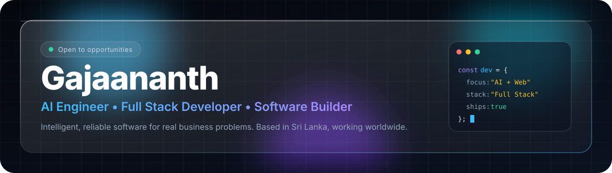
</a>

 

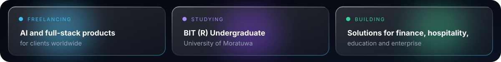

## About

I'm a **freelance AI and full-stack developer** and a **BIT (R) undergraduate at the University of Moratuwa**, based in Batticaloa and working with clients worldwide. I design and ship production software: web apps, mobile apps, backend systems and AI workflows for **finance, hospitality, education and enterprise**.

| | |
|---|---|
| **Focus** | AI-powered products, intelligent web systems, reliable backends |
| **Approach** | Real problems first, clean architecture, software that runs in production |
| **Location** | Batticaloa, Sri Lanka, working worldwide |
| **Status** | Open to freelance projects and collaboration |

## What I Build

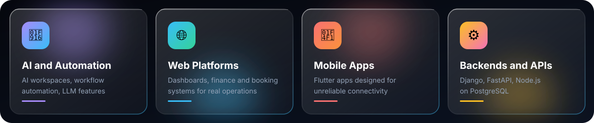

## Featured Projects

<table>
  <tr>
    <td><a href="https://github.com/Gajaananth/Selva_NaDhanam">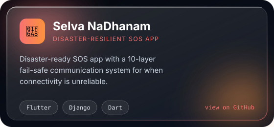</a></td>
    <td><a href="https://gajaananth.vercel.app/">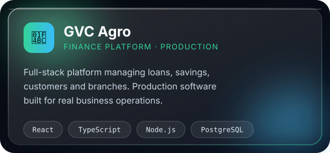</a></td>
  </tr>
  <tr>
    <td><a href="https://gajaananth.vercel.app/">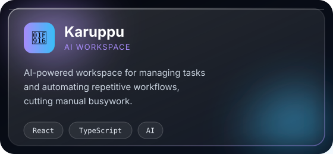</a></td>
    <td><a href="https://gajaananth.vercel.app/">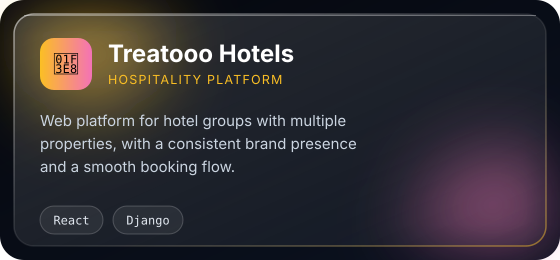</a></td>
  </tr>
  <tr>
    <td><a href="https://github.com/Gajaananth/dearo_backend">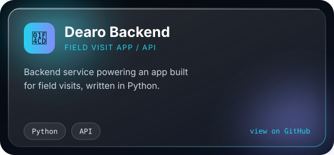</a></td>
    <td><a href="https://github.com/Gajaananth?tab=repositories">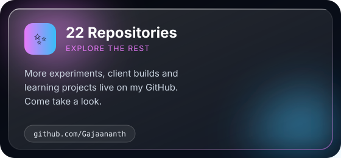</a></td>
  </tr>
</table>
Case studies and live demos on my <a href="https://gajaananth.vercel.app/">portfolio</a>.

## How I Work

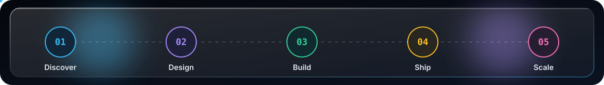

## Tech Stack

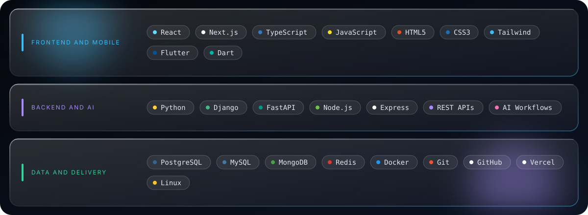

## GitHub Activity

  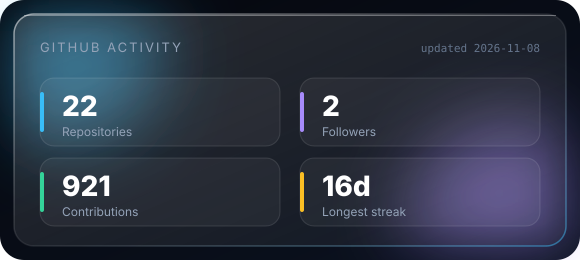
  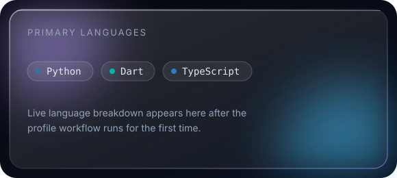
  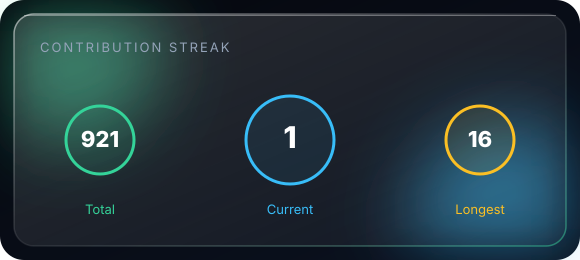
    
  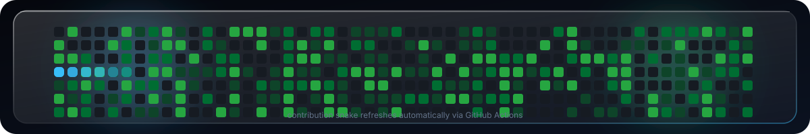

 

